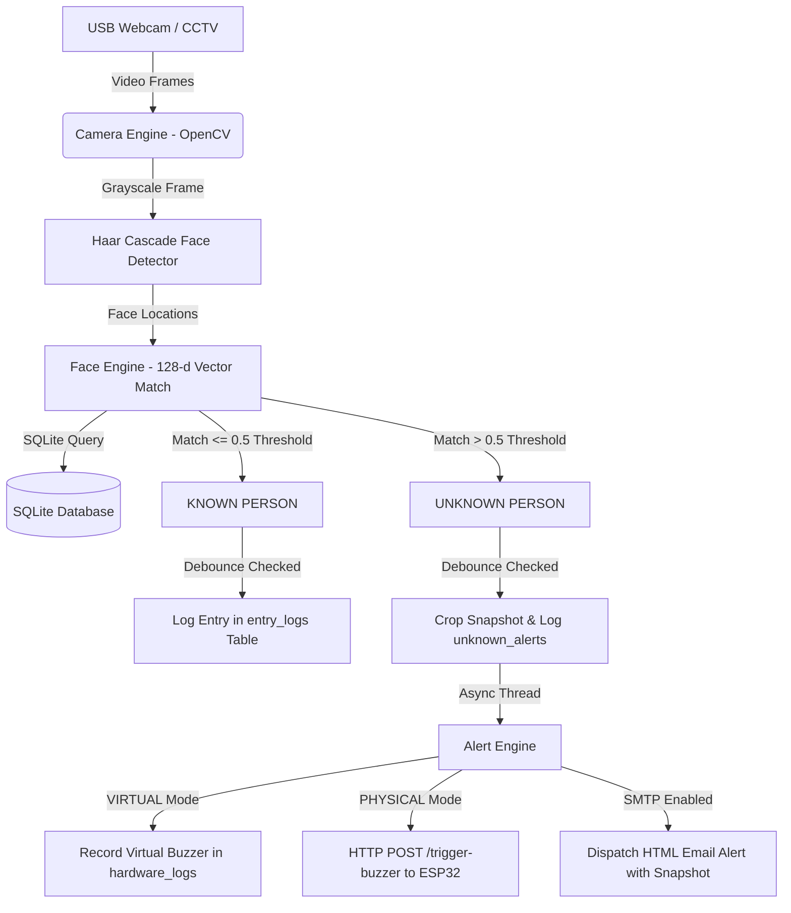

# Academic Project Report: AI-Based Campus Security System Using Facial Recognition

**Project Title**: AI-Based Campus Security System Using Facial Recognition  
**System Type**: Authorized Campus Access Monitoring & Security Prototype  
**Technology Stack**: Python 3.11, Flask 3.0, SQLite 3, OpenCV 4.9, face_recognition, dlib, NumPy  

---

## 1. Abstract

The **AI-Based Campus Security System Using Facial Recognition** is an automated, locally-hosted access control prototype designed to monitor campus gate checkpoints. Built with Python, Flask, OpenCV, and 128-dimensional facial embeddings (`face_recognition`/`dlib`), the system continuously analyzes video frames from an entrance camera, matching detected faces against an offline database of authorized students, faculty, and staff.

Upon identifying a registered person, the system displays their credentials (Name, ID, Department, Role) on an operator preview screen and records an entrance event log into SQLite. When an unregistered or unmatched face is detected, the system classifies it as `UNKNOWN`, crops a single intruder event snapshot image, records an alert log, dispatches simulated virtual buzzer hardware triggers, and provides optional SMTP email notifications. The system features a debouncing mechanism (`DEBOUNCE_COOLDOWN_SECONDS=5`) to prevent frame-flooding, dual execution modes (`VIRTUAL` simulator vs `PHYSICAL` ESP32), and strict offline biometric data privacy controls.

---

## 2. Problem Statement

Traditional campus access monitoring relies heavily on manual identity verification by security personnel or physical RFID/smart card scanning. These traditional approaches present several vulnerabilities:
1. **Manual Gate Inspection Bottlenecks**: Security guards cannot manually verify thousands of student IDs during peak campus entry hours.
2. **Card Misplacement & Proxy Entry**: Physical ID cards can be lost, stolen, or shared among unauthorized individuals (proxy attendance/entry).
3. **Lack of Real-Time Intruder Logging**: Unauthorized entries often go undetected or unrecorded, leaving security teams without verifiable event logs or snapshot evidence.
4. **Cloud Privacy & Cost Concerns**: Commercial cloud-based facial recognition solutions involve recurring subscription costs and transmit sensitive student biometric data over public networks.

---

## 3. Project Objectives

- **Offline Biometric Processing**: Implement an offline facial recognition pipeline that runs entirely on local hardware without cloud dependencies.
- **Biometric Enrollment & Single-Face Rule**: Provide a consent-aware registration module that validates enrollment photos and generates 128-dimensional vector embeddings.
- **Real-Time Entrance Verification**: Perform continuous face detection and vector distance matching at gate checkpoints.
- **Debounced Access & Intruder Logging**: Maintain accurate entrance logs for authorized personnel and snapshot alert records for unknown faces without generating duplicate database records every camera frame.
- **Dual Hardware & Alert Architecture**: Support both a Virtual Hardware Simulator for local PC demonstration and physical ESP32 microcontroller buzzer activation over Wi-Fi.

---

## 4. Existing System vs. Proposed System

| Feature | Existing Manual / Card System | Proposed AI Facial Recognition System |
| :--- | :--- | :--- |
| **Authentication Method** | Physical ID Card / Visual Guard Check | Biometric 128-d Facial Vector Embedding |
| **Speed & Automation** | Slow, manual inspection | Fast, real-time automated video frame matching |
| **Proxy Prevention** | Vulnerable to shared/stolen cards | High security; biometric face presence required |
| **Intruder Alerts** | Verbal guard intervention | Automated snapshot capture, dashboard alert & buzzer trigger |
| **Data Privacy** | Paper logs or cloud vendor systems | 100% local, offline SQLite database storage |
| **Event History** | Difficult to search or filter | Instant database search, filter, and analytics |

---

## 5. System Architecture

The application follows a modular MVC (Model-View-Controller) architecture split into clear layers:



---

## 6. Modules and Their Responsibilities

1. **`app.py`**: Application factory (`create_app()`), Blueprint registration, and server startup.
2. **`config.py`**: Configuration manager resolving absolute directory paths, upload folders (`/static/uploads/registered/`, `/static/uploads/unknowns/`), environment parameters, and default fallbacks.
3. **`core/database.py`**: SQLite connection factory (`get_db_connection()`), context manager (`get_db()`), schema runner & auto-migrator (`init_db()`), default admin seeder, and `system_config` key-value helpers.
4. **`core/face_engine.py`**: Biometric core responsible for 128-d facial vector extraction (`extract_face_encoding()`), single-face validation, JSON vector serialization (`serialize_encoding()`), Euclidean distance calculation (`calculate_face_distance()`), and in-memory matching (`match_face_encoding()`).
5. **`core/camera_engine.py`**: Thread-safe OpenCV video feed manager (`CameraEngine`), MJPEG stream generator (`generate_mjpeg_stream()`), face detection bounding box overlay, identity matching, and debounced event logging (`_log_known_entry()` & `_log_unknown_alert()`).
6. **`core/alert_engine.py`**: Non-blocking asynchronous worker thread dispatcher (`trigger_unknown_event_alerts()`) handling SMTP HTML email delivery (`dispatch_email_alert()`) and dual-mode hardware buzzer triggers (`dispatch_hardware_buzzer()`).
7. **`routes/auth_routes.py`**: Admin login (`/login`), logout (`/logout`), and protected control center dashboard (`/dashboard`).
8. **`routes/person_routes.py`**: Biometric person registration (`/register`), personnel directory (`/persons`), deletion (`/persons/delete/<id>`), and authenticated image serving (`/uploads/registered/<file>`, `/uploads/unknowns/<file>`).
9. **`routes/camera_routes.py`**: Camera control panel (`/camera`), video feed stream (`/camera/video_feed`), start (`/camera/start`), stop (`/camera/stop`), and status (`/camera/status`).

---

## 7. Database Tables and Relationships

The SQLite database (`campus_security.db`) comprises 7 normalized tables:

```sql
-- 1. Admin Authentication Table
CREATE TABLE admin_users (
    id INTEGER PRIMARY KEY AUTOINCREMENT,
    username TEXT UNIQUE NOT NULL,
    password_hash TEXT NOT NULL,
    created_at DATETIME DEFAULT CURRENT_TIMESTAMP
);

-- 2. Authorized Personnel Directory
CREATE TABLE registered_persons (
    id INTEGER PRIMARY KEY AUTOINCREMENT,
    person_id TEXT UNIQUE NOT NULL,
    full_name TEXT NOT NULL,
    department TEXT NOT NULL,
    role TEXT NOT NULL CHECK(role IN ('Student', 'Faculty', 'Staff', 'Visitor')),
    email TEXT,
    photo_path TEXT NOT NULL,
    consent_given INTEGER DEFAULT 1,
    is_active INTEGER DEFAULT 1,
    created_at DATETIME DEFAULT CURRENT_TIMESTAMP
);

-- 3. Facial Embedding Vectors
CREATE TABLE face_encodings (
    id INTEGER PRIMARY KEY AUTOINCREMENT,
    person_id TEXT NOT NULL,
    encoding_data BLOB NOT NULL,
    created_at DATETIME DEFAULT CURRENT_TIMESTAMP,
    FOREIGN KEY(person_id) REFERENCES registered_persons(person_id) ON DELETE CASCADE
);

-- 4. Known Person Authorized Entry History
CREATE TABLE entry_logs (
    id INTEGER PRIMARY KEY AUTOINCREMENT,
    person_id TEXT NOT NULL,
    timestamp DATETIME DEFAULT CURRENT_TIMESTAMP,
    confidence_score REAL NOT NULL,
    gate_location TEXT DEFAULT 'Main Campus Gate 1',
    FOREIGN KEY(person_id) REFERENCES registered_persons(person_id) ON DELETE CASCADE
);

-- 5. Unknown Person Intrusion Alerts
CREATE TABLE unknown_alerts (
    id INTEGER PRIMARY KEY AUTOINCREMENT,
    snapshot_path TEXT NOT NULL,
    timestamp DATETIME DEFAULT CURRENT_TIMESTAMP,
    gate_location TEXT DEFAULT 'Main Campus Gate 1',
    status TEXT DEFAULT 'UNRESOLVED' CHECK(status IN ('UNRESOLVED', 'RESOLVED', 'FALSE_ALARM')),
    hardware_mode TEXT DEFAULT 'VIRTUAL',
    esp32_triggered INTEGER DEFAULT 0,
    email_sent INTEGER DEFAULT 0,
    notes TEXT
);

-- 6. Hardware Buzzer Activation Logs
CREATE TABLE hardware_logs (
    id INTEGER PRIMARY KEY AUTOINCREMENT,
    mode TEXT NOT NULL CHECK(mode IN ('VIRTUAL', 'PHYSICAL')),
    event_type TEXT NOT NULL,
    details TEXT,
    timestamp DATETIME DEFAULT CURRENT_TIMESTAMP
);

-- 7. Dynamic System Configuration
CREATE TABLE system_config (
    id INTEGER PRIMARY KEY AUTOINCREMENT,
    config_key TEXT UNIQUE NOT NULL,
    config_value TEXT NOT NULL,
    description TEXT
);
```

---

## 8. System Workflow & Event Processing Logic

### Registration Workflow
1. Administrator inputs person metadata (Name, ID, Role, Department, Email) and selects an enrollment photo.
2. Form validates the mandatory **Biometric Consent** checkbox.
3. System verifies `person_id` uniqueness in SQLite.
4. `PIL.Image` verifies image integrity and saves the file with a secure UUID filename.
5. `face_engine.extract_face_encoding()` detects faces:
   - If 0 faces or >1 face detected $\rightarrow$ deletes uploaded file and returns helpful flash error.
   - If exactly 1 face detected $\rightarrow$ generates 128-d float vector.
6. Database inserts records into `registered_persons` and `face_encodings` within a single SQLite transaction.

### Camera Recognition & Debounced Logging Workflow
1. Operator starts live camera from `/camera`.
2. `CameraEngine` loads active 128-d face encodings into memory (`load_enrolled_encodings()`).
3. Frame is captured from webcam (`cv2.VideoCapture`).
4. Face locations are detected and passed to `face_recognition.face_encodings()`.
5. Each detected 128-d vector is compared against enrolled vectors (`match_face_encoding()`):
   - **Match Found (`dist <= 0.5`)**:
     - Bounding Box: Cyan/Green `MATCH: Name (ID) | Dist: 0.38`.
     - Check Debounce Cooldown (`time.time() - last_logged >= 5s`).
     - If cooldown passed $\rightarrow$ inserts row into `entry_logs` and updates timestamp cache.
   - **No Match Found (`dist > 0.5`)**:
     - Bounding Box: Amber/Orange `UNKNOWN (No Enrolled Match) | Dist: 0.68`.
     - Check Debounce Cooldown (`time.time() - last_logged >= 5s`).
     - If cooldown passed $\rightarrow$ crops face image, saves snapshot file to `/static/uploads/unknowns/`, inserts row into `unknown_alerts`, and dispatches background alert worker (`trigger_unknown_event_alerts()`).

---

## 9. Testing and Observed Results

Automated test suites were developed for each module and executed locally:

| Test Suite | Test Focus | Result |
| :--- | :--- | :--- |
| **`scripts/test_database.py`** | SQLite Schema initialization, table creation, default admin seeding (`admin`/`admin123`), and system_config parameters | **PASSED** |
| **`scripts/test_registration.py`** | Allowed file extension check, 0-face rejection, 128-d vector JSON serialization/deserialization, and vector distance math | **PASSED** |
| **`scripts/test_camera.py`** | CameraEngine initialization, non-existent device graceful error handling, mocked resource cleanup, synthetic frame face overlay, and route `@login_required` protection | **PASSED** |
| **`scripts/test_recognition.py`** | Known encoding matching (`dist <= 0.5`), unknown vector rejection (`dist > 0.5`), 5s debounce cooldown window verification, and corrupted encoding resiliency | **PASSED** |
| **`scripts/test_notifications.py`** | Disabled SMTP handling, missing credentials fallback, mocked SMTP email delivery, virtual buzzer log recording, mocked ESP32 HTTP POST trigger, ESP32 network timeout logging, missing snapshot SVG fallback, and full regression test execution | **PASSED** |

---

## 10. Limitations and Future Enhancements

### Limitations
1. **Virtual Hardware Default**: Physical ESP32 hardware buzzer activation requires setting `HARDWARE_MODE=PHYSICAL`, flashing the ESP32 firmware sketch, and connecting over Wi-Fi. In default `VIRTUAL` mode, buzzer events are simulated.
2. **Lighting & Pose Sensitivity**: Recognition accuracy requires adequate frontal lighting and un-obscured facial features.
3. **"UNKNOWN" Classification Scope**: An `UNKNOWN` classification simply indicates that no registered face matched below the configured distance threshold (`0.5`). It does not constitute legal proof of an unauthorized intruder.

### Future Enhancements
- **Multi-Camera Gate Support**: Extending `camera_engine.py` to manage multiple video feeds simultaneously across different entrance gates.
- **Mobile Security App**: Building an Android/iOS PWA for security personnel to receive push notifications and view live snapshot alerts on mobile devices.
- **Liveness Detection**: Integrating anti-spoofing micro-expression analysis to prevent photo/screen spoofing.

---

## 11. Conclusion

The **AI-Based Campus Security System** successfully demonstrates a practical, offline-first biometric access control solution. By combining modern computer vision (`OpenCV`), 128-dimensional facial embeddings (`face_recognition`/`dlib`), robust debounced logging, and a modular dual hardware architecture (`VIRTUAL` simulator vs `PHYSICAL` ESP32), the system delivers real-time gate monitoring while maintaining strict student biometric data privacy.
